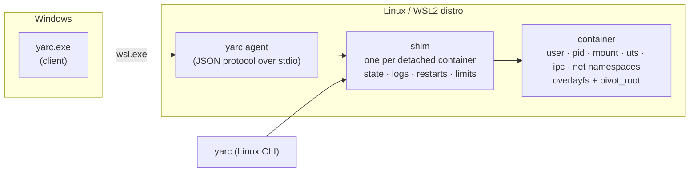

<div align="center">

# yarc

### Yet Another Runtime Container

**Run OCI images and Docker Compose projects without Docker.**
Rootless, daemonless, written in Rust. Runs on Linux and on Windows through WSL2.

[](https://github.com/FrancoMelandri/yarc/actions/workflows/ci.yml)
[](https://github.com/FrancoMelandri/yarc/releases)
[](#license)

-lightgrey.svg)

</div>

---

```console
$ yarc run --rm alpine:3.20 echo "hello from a container"
hello from a container

$ yarc up -d
db:  created and started shop-db-1
api: created and started shop-api-1

$ yarc stats
CONTAINER ID   CPU %    MEM USAGE / LIMIT   MEM %   PIDS
shop-api-1      3.1%  212.4 MiB / 768.0 MiB   27.7%     41
shop-db-1       0.4%   28.9 MiB / 256.0 MiB   11.3%     44
```

yarc is a small container runtime that was built to understand every layer: it pulls
images from a registry, unpacks them, sets up namespaces and mounts, supervises the
processes and wires projects together, all by itself, as an ordinary user, with no
daemon and no root. Point it at a `docker-compose.yml` you already have and it starts the services.

## Highlights

| Feature | What you get |
|---|---|
| **No Docker, no daemon, no root** | Pulls images itself (registry v2, token auth, multi-arch), unpacks them and runs them in user, pid, mount, uts, ipc and network namespaces with `overlayfs` and `pivot_root`. |
| **Reads your Compose files as they are** | `docker-compose.yml` / `compose.yaml`, `.env` and `--env-file`, `${VAR:-default}` interpolation, profiles, healthchecks, `depends_on` conditions, file secrets, restart policies. Unsupported keys are *errors*, never silently ignored. |
| **Windows, natively driven** | `yarc.exe` forwards every command to a Linux `yarc` running in your WSL2 distro. Paths are translated, Ctrl-C works, ports are reachable from Windows. |
| **Restart policies that mean it** | `always`, `unless-stopped`, `on-failure[:N]` with exponential backoff. A `stop`, `down`, `rm -f` or `kill` is always final. |
| **CPU, memory and process limits** | `-m 512m --cpus 0.5 --pids-limit 200`. Enforced by the kernel through a systemd scope, OOM kills are reported (`Exited (137) OOM killed`), and a JVM sizes its heap from them. |
| **A network per project** | Services share one project network namespace: they reach each other by service name, published (TCP) ports are bound to `127.0.0.1`, outbound traffic goes through `pasta`. |
| **Health checks & exec** | Shell health checks drive `service_healthy` start ordering; `yarc exec` runs commands in a running container. |
| **Secrets & volumes** | File secrets are mounted read-only at `/run/secrets/<name>`; named volumes and host bind mounts (`:ro`) are supported. |
| **Offline friendly** | `yarc load images.tar` imports an OCI archive, no registry needed. |

## Quick start

### Linux

```sh
# download the latest release, then
tar xzf yarc-*-linux-x86_64.tar.gz
sudo install yarc-*-linux-x86_64/yarc /usr/local/bin/

yarc doctor                       # checks that containers can run here
yarc run --rm alpine:3.20 cat /etc/os-release
```

### Windows (WSL2)

yarc on Windows is a thin client: the runtime itself lives in a WSL2 distro.

1. Install WSL2 and a distro (for example Ubuntu 24.04).
2. Put the **Linux** binary on the distro's `PATH` (from the `linux-x86_64` archive).
3. Put `yarc.exe` (from the `windows-x86_64` archive) on your Windows `PATH`.
4. Run it from PowerShell:

```powershell
yarc doctor                       # checks the WSL distro
yarc run --rm alpine:3.20 echo hello
```

Which distro and which Linux binary the client uses is configurable:

| Variable | Meaning | Default |
|---|---|---|
| `YARC_WSL_DISTRO` | WSL distro to use | WSL's default distro |
| `YARC_WSL_BIN` | Linux `yarc` to run (absolute path or a name on the distro's `PATH`) | `yarc` |
| `YARC_WSL_EXE` | the launcher | `wsl.exe` |

### Requirements (inside Linux / WSL)

- Linux kernel with **unprivileged user namespaces** and cgroup v2 (WSL2's default kernel qualifies).
- Binaries are built on Ubuntu 22.04 (glibc): they run on Ubuntu 22.04+ and Debian 12+ or newer.
- Optional: [`passt`](https://passt.top) (`pasta`) for outbound network access from project containers.
- Optional: **systemd for your user**, needed *only* for containers that have limits.
  On WSL add `[boot]` / `systemd=true` to `/etc/wsl.conf` and run `wsl --shutdown`.

## Running containers

```sh
yarc pull alpine:3.20                          # fetch an image (also done automatically)
yarc run --rm alpine:3.20 echo hi              # create + start + remove
yarc run -d --name web -e MODE=prod nginx      # run in the background
yarc ps                                        # running containers (-a for all)
yarc logs -f web                               # follow the output
yarc exec web nginx -t                         # run a command inside
yarc stop web && yarc rm web                   # SIGTERM, then SIGKILL after a timeout
```

Every container command also works under `container` (`yarc container ls`, …).
Useful flags of `run` / `create`:

| Flag | |
|---|---|
| `--name`, `-e KEY=VALUE`, `-w DIR`, `-u USER` | name, environment, working directory, user |
| `--entrypoint CMD` | override the image's entrypoint (`""` clears it) |
| `--network host\|none` | share the host's network, or loopback only |
| `--restart POLICY` | `no`, `always`, `unless-stopped`, `on-failure[:N]` (with `-d`) |
| `-m, --memory SIZE` · `--memory-swap SIZE` · `--cpus N` · `--pids-limit N` | [limits](#cpu-and-memory-limits) |
| `--rm`, `-d`, `--debug` | remove on exit, background, print the setup plan |

Images: `yarc pull`, `yarc load FILE`, `yarc image ls`, `yarc image rm`, `yarc image unpack`.

## Projects: Compose files and `yarc.yaml`

`yarc up` reads the project file in the current directory (`yarc.yaml`, or else a
`compose.yaml` / `docker-compose.yml`) or the one named with `-f FILE`.

```yaml
# docker-compose.yml, used as it is
services:
  db:
    image: myorg/db:1.4
    environment:
      DB_PASSWORD_FILE: /run/secrets/db_password
    secrets: [db_password]
    volumes: ["dbdata:/var/lib/db"]
    healthcheck:
      test: ["CMD-SHELL", "db-ready"]
      interval: 5s
    restart: unless-stopped
    deploy:
      resources:
        limits: { memory: 512M, cpus: "1" }

  api:
    image: myorg/api:1.2
    ports: ["8080:80"]
    environment:
      DATABASE_URL: db://db:5432/${DB_NAME:-shop}
    depends_on:
      db: { condition: service_healthy }

secrets:
  db_password: { file: ./secrets/db_password.txt }
volumes:
  dbdata:
```

```sh
yarc up -d                    # create and start everything, in dependency order
yarc project ps               # services, containers, status, ports
yarc project logs -f api      # logs of one or more services
yarc project config           # what yarc understood (limits, restart, profiles, …)
yarc project stop             # stop, keep containers
yarc down [-v]                # stop and remove containers, network (and volumes)
```

`up` is idempotent: it leaves up-to-date containers alone and **recreates a service whose
definition changed** (image, command, environment, ports, volumes, limits, …).

<details>
<summary><b>Supported Compose keys</b></summary>

`image`, `command`, `entrypoint`, `environment` (list or map), `ports` (short form, TCP,
published on `127.0.0.1`), `volumes` (short form), top-level `volumes` (names only),
`depends_on` (list, or with `service_started` / `service_healthy`), `user`, `working_dir`,
`healthcheck` (`test`, `interval`), `container_name` (an extra name on the project network),
file `secrets` (short form), `profiles`, `stop_grace_period`, `restart`, and the limits
`mem_limit`, `memswap_limit`, `cpus`, `pids_limit`, `deploy.resources.limits`
(`deploy.resources.reservations` is accepted and ignored).

`x-…` keys and `version` are ignored. **Every other key is an error** that names the key
(`build`, `networks`, `deploy.replicas`, `cpu_shares`, ...), so a file is never half-understood.

A service may carry an `x-yarc:` block with yarc-only settings; today `user: root`, which images
declaring a non-root `USER` need (see [Limitations](#limitations)). Docker ignores the block.

</details>

<details>
<summary><b>Variables, profiles and the native <code>yarc.yaml</code></b></summary>

- **Variables:** `${VAR}`, `${VAR:-default}`, `${VAR:?message}` and the other forms. Values come from the
  process environment, then the `.env` next to the file, or from `--env-file` files instead of it
  (repeatable, later files win). Error messages never print values.
- **Profiles:** `--profile NAME` (repeatable), `COMPOSE_PROFILES` in the environment or in the env file;
  `*` activates all. Skipped services are announced, and a service that needs a skipped one is an error.
- **`yarc.yaml`:** a smaller native format with short keys:

```yaml
services:
  db:
    image: myorg/db:1.4
    env: { DB_PASSWORD: secret }
    volumes: ["dbdata:/var/lib/db"]
    health: { cmd: "db-ready", interval: 5s }
    resources: { memory: 512m, cpus: 1 }
  api:
    image: myorg/api:1.2
    ports: ["8080:80"]
    needs: { db: healthy }
```

</details>

## CPU and memory limits

```sh
yarc run -d -m 512m --cpus 0.5 --pids-limit 200 alpine sleep 300
yarc stats
```

| Where | Keys |
|---|---|
| `run` / `create` | `-m, --memory`, `--memory-swap` (memory **plus** swap, like Docker), `--cpus`, `--pids-limit` |
| Compose | `mem_limit`, `memswap_limit`, `cpus`, `pids_limit`, `deploy.resources.limits` (`memory`, `cpus`, `pids`) |
| `yarc.yaml` | `resources: { memory, memory_swap, cpus, pids }` |

- Sizes are `512m`, `1g`, `1.5g`, `256mb` or plain bytes; the minimum memory is 6 MB, `cpus` is at least 0.01 and at most the machine's CPUs.
- **Going over the memory limit kills the container** (exit 137) and `yarc ps` says so: `Exited (137) OOM killed`, or `Restarting (exit 137, OOM killed, in 4s)` under a restart policy. With a memory limit and no `--memory-swap`, there is **no swap**, so the outcome is predictable.
- `yarc stats` shows memory used / limit, CPU % and processes for running containers that have limits.
- Containers see their limits: a JVM sizes its heap from them (with `-m 768m --cpus 1` the PMS image reported a 768 MiB limit and one CPU).
- A limit is a promise: if systemd cannot create the scope, the container **refuses to start** and tells you how to enable it, rather than running unlimited.

<details>
<summary><b>How it works</b></summary>

A rootless process cannot write cgroup files from a `wsl.exe` session, but it can ask the user's systemd for a transient scope. A container *with* limits has its supervisor started as
`systemd-run --user --scope -p MemoryMax=… -p MemorySwapMax=… -p CPUQuota=…% -p TasksMax=…`; everything it forks stays inside. The scope lives as long as the supervisor, so limits survive restarts, and nothing is left behind after `stop`, `down` or `rm -f`. A container without limits starts exactly as before. Design notes: [docs/design.md](docs/design.md#cpu-and-memory-limits).

</details>

## How it works



- **No daemon.** `yarc run -d` starts a small supervisor, the *shim*, in its own session. It holds the container's lock (the lock, not a pid, defines "running"), records `state.json` and a JSON-lines log, and carries out the restart policy.
- **Rootless.** One user namespace per container maps your uid to root inside it. Layers are unpacked into a content-addressed store and mounted with `overlayfs`.
- **Per-project network.** A holder process keeps one user + network namespace per project; services join it. Service names resolve to `127.0.0.1` through a generated `/etc/hosts`, published ports are forwarded by a small userspace proxy bound to `127.0.0.1`, and outbound traffic and DNS go through `pasta` and the host resolver.
- **A client/agent protocol.** The Windows client and the agent speak a small versioned JSON protocol; paths are translated, signals and exit codes pass through.

## Limitations

yarc is deliberately small and **young (0.0.x)**. Know before you rely on it:

- **Rootless only.** Containers map a single uid, so an image that declares a non-root `USER` needs `--user root` / `x-yarc: { user: root }`.
- **No `build:`**: no Dockerfile or BuildKit; bring images from a registry or `yarc load`.
- **No compose `networks:`**: each project has exactly one network.
- Only **TCP** ports are published, on `127.0.0.1` (UDP mappings are ignored with a warning); there is no per-container IP.
- `always` and `unless-stopped` behave the same: there is no boot-time supervisor.
- Limits: no `cpu_shares`, `cpuset`, `ulimits`, block I/O limits or live update; `reservations` is ignored.
- Linux x86_64 and Windows x86_64 binaries are released; macOS is not implemented.

## Build from source

```sh
git clone https://github.com/FrancoMelandri/yarc.git && cd yarc
cargo build --release -p yarc-cli          # → target/release/yarc
cargo test --workspace                     # unit and integration tests (any OS)
```

The live suites run real containers (network and user namespaces needed):

```sh
cargo test -p yarc-cli --test live_run -- --ignored
cargo test -p yarc-cli --test live_limits -- --ignored --test-threads=1
```

| Crate | Role |
|---|---|
| `yarc-cli` | the `yarc` binary: commands, projects, the Windows client |
| `yarc-runtime` | namespaces, mounts, supervision, restart and limits |
| `yarc-oci` | references, registry client, blob store, unpacking |
| `yarc-config` | `yarc.yaml` and Compose readers, variables, limits model |
| `yarc-proto` / `yarc-agent` | client ⇄ agent protocol and the agent |

Pull requests are checked by [CI](.github/workflows/ci.yml) on Linux and Windows; a merge to `main` tags the
crate version and the [build workflow](.github/workflows/build.yml) publishes the release archives.

## Documentation

- [docs/design.md](docs/design.md): goals, architecture and decisions
- [docs/progress/](docs/progress): one note per milestone: what was built, measured and left out

## License

[MIT](Cargo.toml)
